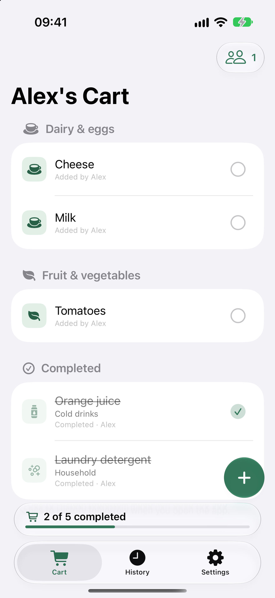
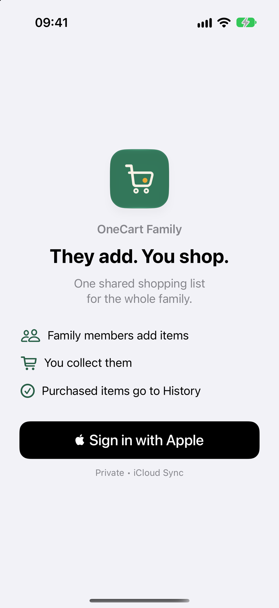
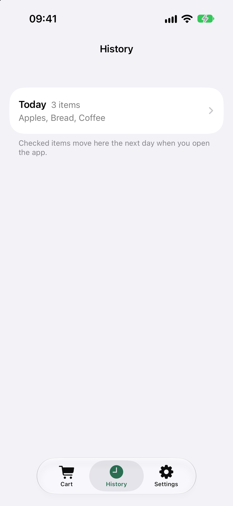
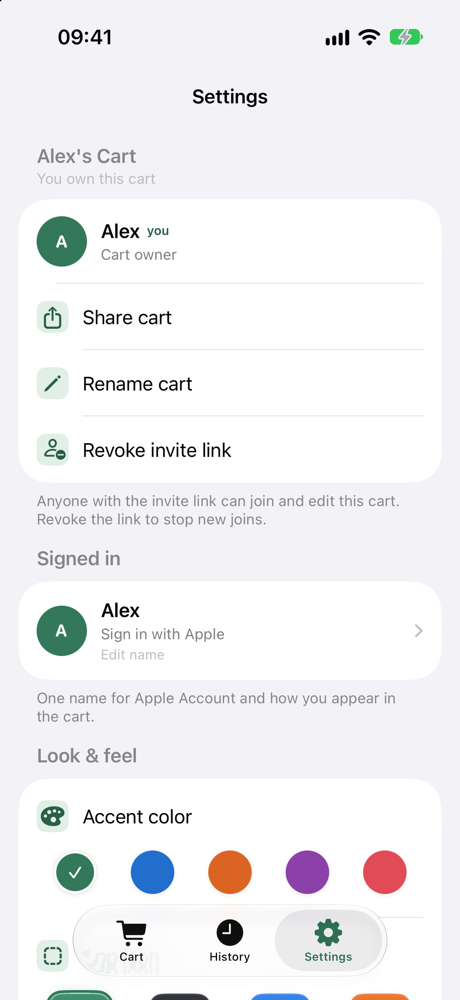

# OneCart Family

One shared shopping cart for the whole family: anyone adds what is needed, the shopper checks
items off in the store, and everyone follows the progress and sees what was bought, day by day.

Available on the [App Store](https://apps.apple.com/app/id6793219621) as OneCart Family.

<p></p>

## Features

- One living family cart: add items by name, mark them **Completed** at the store.
- **History by day**: items completed on an earlier day move to History when the app opens.
- Family sharing through a `CKShare` invite link, with member list, leave and revoke-invite.
- Sign in with Apple; sync runs through iCloud / CloudKit and works offline-first.
- Home Screen and Lock Screen widgets, a shopping-trip Live Activity, and Siri / Shortcuts
  actions to add items, read what is left and start a trip.
- Quick suggestion chips ranked by purchase history; local notifications for family activity.
- English, Russian and Ukrainian.

**Stack:** Swift 6, SwiftUI, Core Data with CloudKit (private and shared stores, `CKShare`
invites), WidgetKit, Live Activities, App Intents, Foundation Models; iOS 27+, iPhone only.

User-facing product name: **OneCart Family**. The repository, Xcode module and scheme are
named **OneCart**.

### Screenshots

<p>
  
  
  
  
</p>

Store masters and App Store Connect sizes: [`assets/store/`](assets/store/).

## Requirements and tests

Behavior is specified as numbered requirements (`REQ-AREA-NNN`) in
[docs/requirements/product.md](docs/requirements/product.md). Each requirement lists the named
tests that prove it in the [coverage matrix](docs/requirements/product.md#coverage), and the
tests cite the same IDs in their names. Design choices are recorded in
[docs/decisions/](docs/decisions/).

## Building

Bundle ID: `com.vil555tim.onecart`  
CloudKit container: `iCloud.com.vil555tim.onecart`

Open **`OneCart/OneCart.xcodeproj`** (scheme `OneCart`), or use the `just` commands, which
come from the shared build tooling under `Tooling/` (configuration in
[`Tooling/runtime.yml`](Tooling/runtime.yml)):

```bash
brew bundle --file=Tooling/Brewfile
just doctor
just build
just test
just verify   # lint, build, unit and UI tests
```

`just verify` and the GitHub Actions `Tests` workflow run the same checks. The repository has no
git hooks.

For device builds and TestFlight, including App ID capabilities and the CloudKit Production
schema, see [docs/operations/release.md](docs/operations/release.md).

## Layout

```text
.
├── OneCart/                 # App product
│   ├── OneCart.xcodeproj
│   ├── Application/         # App entry, AppSession, root + tabs
│   ├── Features/            # Feature UI + ViewModels
│   ├── Data/                # Persistence, CloudKit, Auth
│   ├── Shared/
│   ├── OneCartWidgets/      # Widgets and Live Activity
│   ├── Resources/
│   ├── Tests/               # Unit tests
│   └── OneCartUITests/      # UI smoke tests
├── docs/                    # See docs/README.md
├── assets/                  # Brand / store masters (not in the app bundle)
├── Tooling/                 # Shared build and CI tooling
├── justfile                 # Imports Tooling/justfile, adds demo recipes
├── README.md
└── AGENTS.md
```

Native SwiftUI only; there is no web or cross-platform stack.

## Documentation

Start at [docs/README.md](docs/README.md): core goals, requirements, decisions, architecture,
release runbook and privacy policy.

## License

Released under the MIT License; see [LICENSE](LICENSE).
